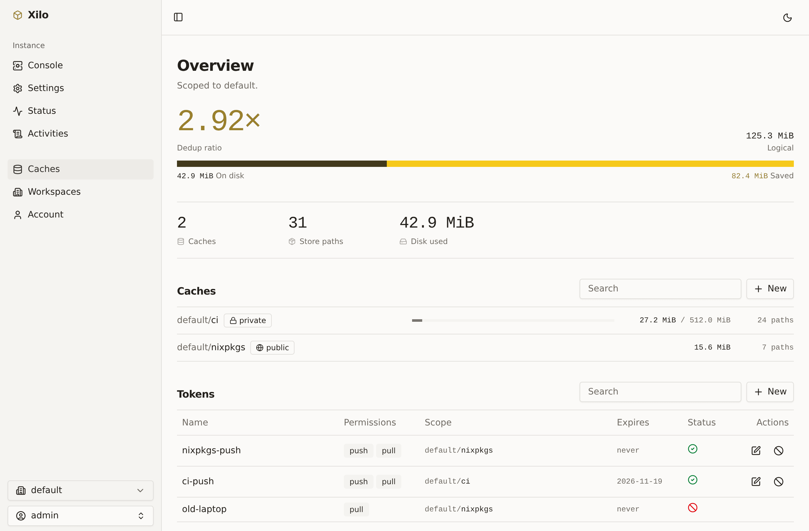
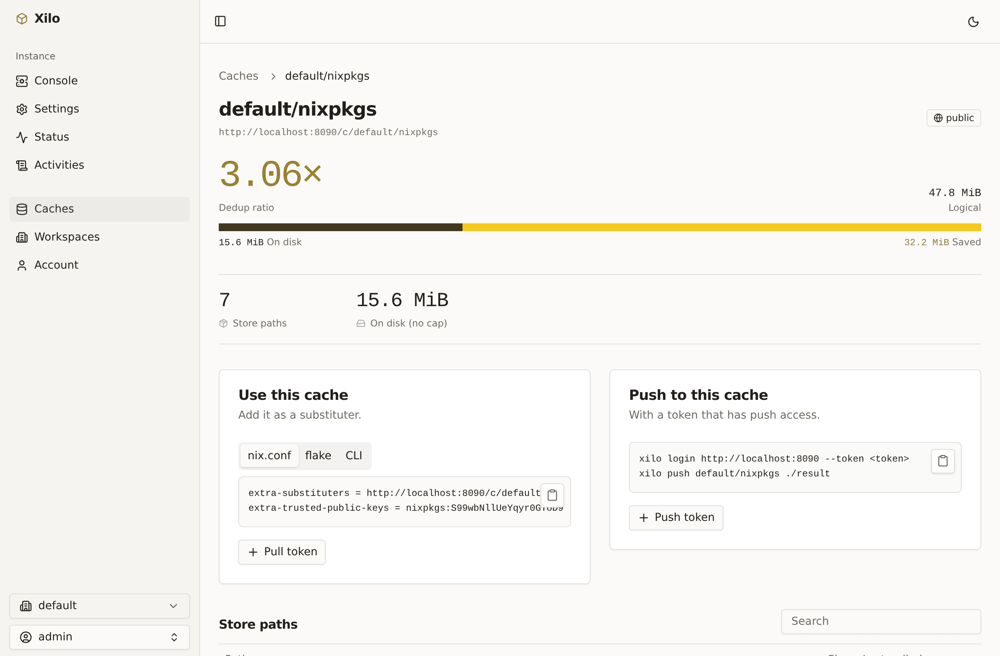
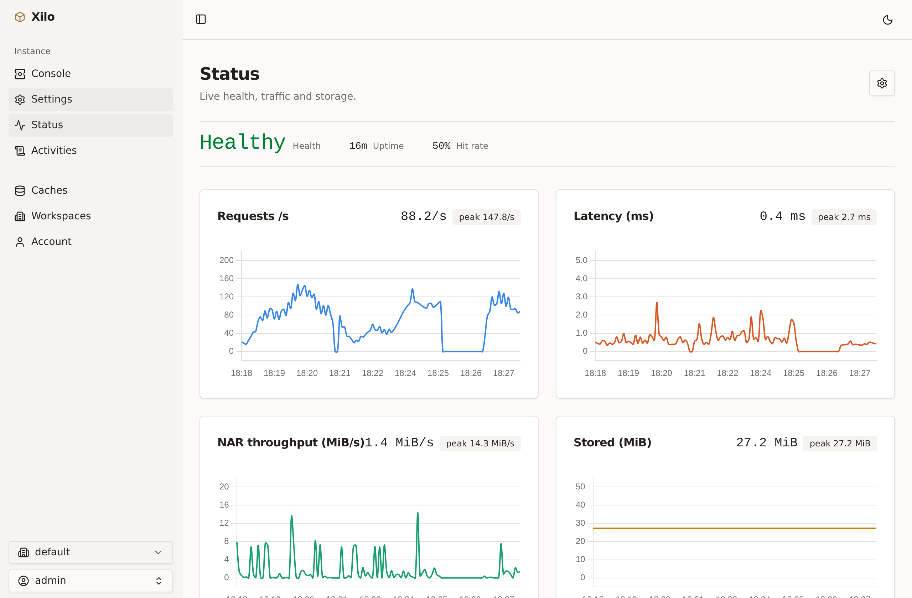
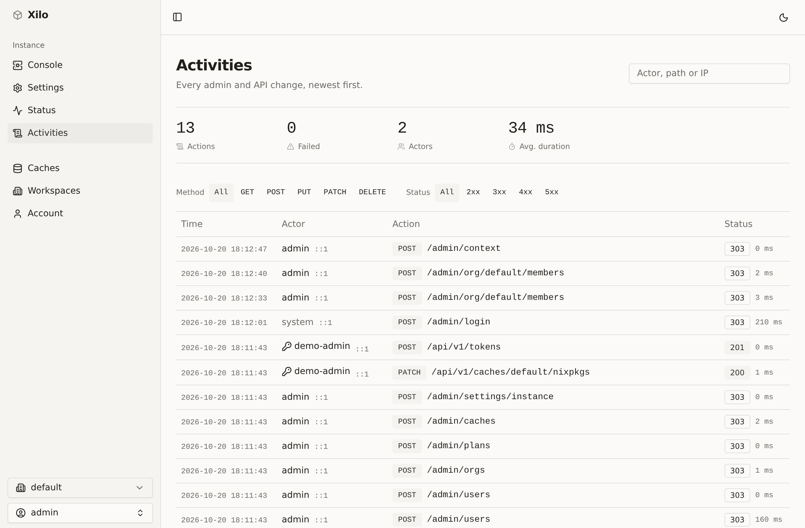
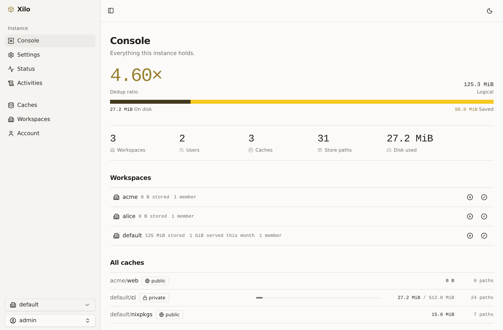
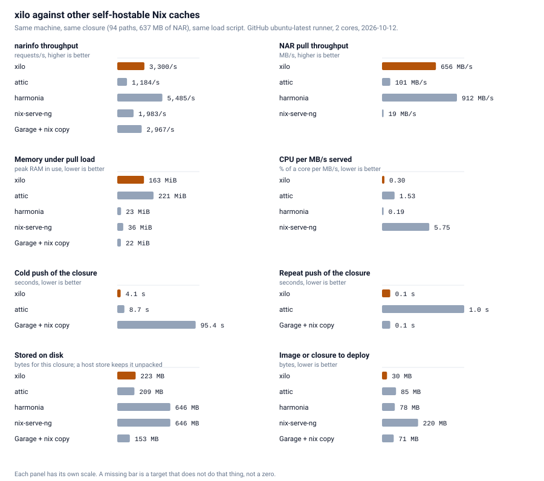

# xilo

[](https://github.com/stubbedev/xilo/actions/workflows/ci.yml)
[](https://github.com/stubbedev/xilo/actions/workflows/ci.yml)
[](https://github.com/stubbedev/xilo/releases/latest)

A self-hosted [Nix binary cache](https://nix.dev/manual/nix/latest/store/types/http-binary-cache-store)
in a single Go binary. One static executable is the server, the admin dashboard and
the push client. It needs no other services.

<picture>
  <source media="(prefers-color-scheme: dark)" srcset="docs/screenshots/dashboard-dark.png">
  
</picture>

## Why xilo

- **One binary, no dependencies.** SQLite or PostgreSQL for metadata, local disk or any
  S3-compatible bucket for data.
- **Deduplicated storage.** Content-defined chunking (FastCDC) shares bytes across every
  path and every cache, and compresses them with zstd at rest.
- **Fast pushes.** The client uploads only the chunks the server is missing, and can skip
  paths an upstream cache such as `cache.nixos.org` already signed.
- **Safe by default.** Tokens are scoped to a single cache and revoked immediately.
  Signing keys never leave the server, and incomplete data fails with an error instead
  of a truncated download.
- **Multi-tenant.** Workspaces, organizations, roles, quotas and optional self-service
  signup.
- **A real dashboard.** Caches, tokens, users, live status and an activity log, in six
  languages, light and dark.

## Quick start

Run the server:

```sh
docker run -d -p 8080:8080 -v xilo-data:/data \
  -e XILO_ADMIN_PASSWORD=change-me ghcr.io/stubbedev/xilo:latest
```

Open <http://localhost:8080/admin>, sign in as `admin`, then create a cache and a push
token. On the cache's page you can copy the setup snippets.

Push to it:

```sh
xilo login http://localhost:8080 --token <token>
xilo push myteam/mycache ./result
```

Pull from it by adding the cache to `nix.conf`. `xilo use myteam/mycache` adds it for you:

```
extra-substituters = http://localhost:8080/c/myteam/mycache
extra-trusted-public-keys = mycache:<public-key>
```

Prebuilt binaries, the Nix flake, and the NixOS and home-manager modules are covered in
[Install](docs/install.md).

## Screenshots

<table>
  <tr>
    <td width="50%">
      <picture>
        <source media="(prefers-color-scheme: dark)" srcset="docs/screenshots/cache-dark.png">
        
      </picture>
      <p align="center"><b>Cache</b>: dedup and setup snippets</p>
    </td>
    <td width="50%">
      <picture>
        <source media="(prefers-color-scheme: dark)" srcset="docs/screenshots/status-dark.png">
        
      </picture>
      <p align="center"><b>Status</b>: live health and traffic</p>
    </td>
  </tr>
  <tr>
    <td width="50%">
      <picture>
        <source media="(prefers-color-scheme: dark)" srcset="docs/screenshots/activities-dark.png">
        
      </picture>
      <p align="center"><b>Activities</b>: every admin and API change</p>
    </td>
    <td width="50%">
      <picture>
        <source media="(prefers-color-scheme: dark)" srcset="docs/screenshots/console-dark.png">
        
      </picture>
      <p align="center"><b>Console</b>: every workspace on the instance</p>
    </td>
  </tr>
</table>

## Performance

<picture>
  <source media="(prefers-color-scheme: dark)" srcset="docs/perf/compare-dark.svg">
  
</picture>

CI measures these numbers and commits them; none are typed in by hand.
[Benchmarks](docs/benchmarks.md) explains the method, and
[Features](docs/features.md) compares xilo with the alternatives feature by feature.

## Documentation

| | |
|---|---|
| [Install](docs/install.md) | Docker, binaries, Nix flake, first run |
| [Usage](docs/usage.md) | pulling, pushing, GitHub Actions, CLI, tokens, organizations |
| [Configuration](docs/configuration.md) | config file, environment, S3, PostgreSQL, NixOS and home-manager modules, TLS |
| [Operations](docs/operations.md) | garbage collection, quotas, fsck, backups, upgrades, metrics |
| [Features](docs/features.md) | the full feature list and a comparison with other caches |
| [Benchmarks](docs/benchmarks.md) | how xilo compares with other caches, and the regression gate |
| [How it works](docs/architecture.md) | request path and what a push avoids doing |
| [Development](docs/development.md) | dev shell, recipes, UI stack, test suites |

## Development

```sh
nix develop    # go, templ, air, just, golangci-lint, ...
just dev       # live-reload server with demo data on :8090 (admin / demo)
just check     # everything CI runs
```

Run `just` to list every recipe. [Development](docs/development.md) has the rest, including
the UI stack and the test suites. [RELEASING.md](./RELEASING.md) covers releases and
[SECURITY.md](./SECURITY.md) covers vulnerability reports.

## License

[MIT](./LICENSE)
