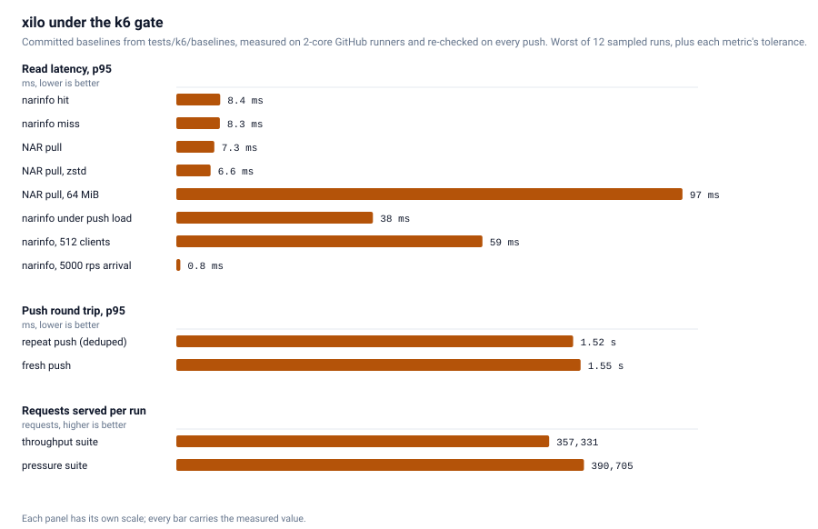

# Benchmarks

Two sets of numbers, both measured and drawn by CI and committed to the
repository: a comparison against the other self-hostable caches, and a gate
against xilo's own past. Nothing here is typed in by hand. The comparison is
re-measured weekly, whenever the harness itself changes, and on every release
([`bench.yml`](../.github/workflows/bench.yml)); both charts are redrawn from
the committed numbers on every push ([`ci.yml`](../.github/workflows/ci.yml)),
so a figure and its chart cannot drift apart. Every chart's caption names the
machine and the date that produced it, because a throughput number without
those is not a measurement.

## Against other Nix caches

<picture>
  <source media="(prefers-color-scheme: dark)" srcset="perf/compare-dark.svg">
  
</picture>

[`tests/bench/bench.sh`](../tests/bench/bench.sh) starts each implementation in
turn, pushes the same closure into it (where it takes a push), runs the same
pull load against it, and samples the container's memory and CPU while that
load runs. [`bench.yml`](../.github/workflows/bench.yml) runs it on the schedule
above and commits what the runner measured, so
[`tests/bench/results.json`](../tests/bench/results.json) is the raw data behind
the chart, which `just perf-charts` (or CI) redraws from it.

| target | what it is | accepts a push | dedup |
|---|---|---|---|
| xilo | this project: SQLite metadata, local chunk storage | over its own API | FastCDC chunks, shared across caches |
| [attic](https://github.com/zhaofengli/attic) | latest published image: SQLite, local storage | over its own API | FastCDC chunks |
| [harmonia](https://github.com/nix-community/harmonia) | serves the host `/nix/store` over HTTP | no, the store is the state | none, the store is the state |
| [nix-serve-ng](https://github.com/aristanetworks/nix-serve-ng) | serves the host `/nix/store` over HTTP | no, the store is the state | none, the store is the state |
| MinIO + `nix copy` | a plain S3 bucket used as a cache | `nix copy --to s3://…` | none, one compressed NAR per path |
| [Garage](https://garagehq.deuxfleurs.fr/) + `nix copy` | the same, on the other self-hostable object store; read over its web endpoint | `nix copy --to s3://…` | none, one compressed NAR per path |

What keeps the comparison honest:

- One target at a time, sequentially, so nothing shares the machine.
- Every server runs in a container, and every memory and CPU figure comes from
  `docker stats` sampled once a second on that container, so a single method
  measures all of them. The memory bar is peak resident memory (RSS: the
  physical RAM the server actually occupied, not what it reserved) during the
  pull phase.
- The pull load is [one k6 script](../tests/bench/pull.js) speaking the plain
  binary-cache protocol, so no implementation gets a client of its own.
- xilo and attic get matching chunk sizes and both compress with zstd at rest.
- CPU is charted per MB/s served rather than raw, because the server that
  serves the least spends the least, which is not the same as costing less.
- `nix copy` writes each NAR compressed and a bucket serves those bytes
  verbatim, so neither bucket's byte rate is the quantity a server
  reassembling identity NARs reports. Both are flagged in the JSON and left
  out of the throughput panels.
- harmonia and nix-serve-ng serve paths that are already in the host store, so
  neither has a push phase. Both answer `Compression: none`, so their byte
  rates are the quantity the other servers report, and their bar in the
  storage panel is the closure's own footprint in `/nix/store`: nothing
  compressed, nothing deduplicated. That is free when the cache is the machine
  that built the paths and the full amount when it is not, which is the trade
  they make rather than a number worth leaving blank.
- Storage is measured as the whole data directory, so a cache's metadata
  counts against it too, not just its chunks.
- Absolute numbers belong to the machine that produced them, named with the
  date in the chart's caption. Read the bars against each other rather than
  against your own hardware.

Reading the panels: xilo and attic are the two that accept a push, chunk it,
deduplicate it and reassemble NARs on the way out, so that is the pairing to
read against each other. A server that hands out the host store has nothing to
reassemble, which is why it can beat a chunk store on raw pull throughput and
run in a fraction of the memory; what it cannot do is take a push from another
machine or compress and dedup what it serves, so its storage bar is the
unpacked closure (the two of them also differ sharply from each other, and the
NAR panels are where that shows). A plain bucket does no work per request and
keeps the fewest bytes, because `nix copy` compresses each NAR once with xz and
the bucket never reassembles anything; it pays for that in push time and in
having no dedup between paths.

To measure your own hardware:

```sh
just bench              # every target, around 20 minutes, needs docker + nix
just bench xilo,attic   # a subset
```

## Against its own past

<picture>
  <source media="(prefers-color-scheme: dark)" srcset="perf/k6-gate-dark.svg">
  
</picture>

Every push to `master` runs the k6 suites in single-tenant and multi-tenant
mode and compares them against the committed baselines in
[`tests/k6/baselines`](../tests/k6/baselines), per-metric tolerances included,
failing the build on a regression
([`perf.yml`](../.github/workflows/perf.yml)). Moving a baseline is therefore a
deliberate commit (`just re-baseline`), which is what makes the chart above a
standard the project holds itself to rather than one good run.

The suites, in [`tests/k6`](../tests/k6/README.md):

- `perf.js`: narinfo hit and miss, NAR pull (identity, zstd stored frames, 64
  MiB NAR), dedup and fresh push, a 4 to 32 VU push saturation ramp, and a
  mixed read/write window.
- `pressure.js`: a 512-VU narinfo storm, a 5000 rps constant-arrival flood, a
  128-VU pull wall with byte-exact verification, an abort storm, and a
  goroutine and heap leak watch.
- `churn.js`: integrity under hostile GC (5 s sweeps, 30 s retention), with
  every pushed NAR pulled back and hash-verified.
- `ops.js`, `mt.js`, `deep.js`: wire-contract and correctness conformance for
  the cache protocol, the tenancy surface and the edge dimensions.
